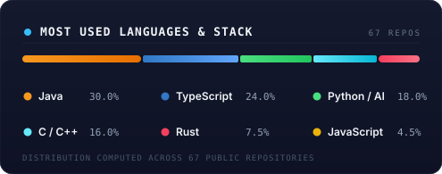

<p align="center">
  
</p>

<p align="center">
  <a href="https://vikashkumarsingh.xyz/"></a>
  <a href="https://www.linkedin.com/in/itsmevikashsingh/"></a>
  <a href="https://github.com/ItsMeVikashKumarSingh"></a>
  <a href="mailto:vikashkumarsingh8352@gmail.com"></a>
</p>

---

### 🏛️ Atelier &amp; Philosophy

> *"Engineering secure, scalable backend architectures from cryptographic primitives to intuitive, reliable user experiences."*

Software Engineer at **Tata Consultancy Services (TCS)** with 67+ public repositories across backend architecture, post-quantum cryptography, AI-driven routing, and Android applications. Dedicated to high-assurance backend systems, cryptographic integrity, and robust software architectures. Passionate about systems programming, privacy-preserving identity protocols, and low-level engineering.

- 🎓 **Academics**: B.Tech in Artificial Intelligence &amp; Data Science (2025) · CGPA 8.14/10
- 📜 **Certifications**: Red Hat Certified System Administrator (**RHCSA**) · Google Cloud Developer Certified
- 📍 **Location**: Vaishali, Bihar, India

---

### 🛠️ Technical Specification

```
┌─────────────────┬──────────────────────────────────────────────────────────────────┐
│ LAYER           │ TECHNOLOGIES & TOOLS                                             │
├─────────────────┼──────────────────────────────────────────────────────────────────┤
│ Core Languages  │ Java (17/21), Python, JavaScript, TypeScript, C, C++, Rust, Bash │
│ Backend Core    │ Spring Boot, Spring Security, Keycloak, Node.js, Express, REST   │
│ AI & Systems    │ Autonomous AI Agents, Multi-Model Routing, SSE Streaming, MCP    │
│ Cryptography    │ Libsodium, Argon2, JWT, TOTP 2FA, ML-KEM / ML-DSA (PQC)         │
│ Storage & Cache │ PostgreSQL, MySQL, MongoDB, Redis, Firebase Firestore            │
│ Systems & Cloud │ Red Hat Enterprise Linux (RHCSA), Docker, Git, GCP, AWS          │
└─────────────────┴──────────────────────────────────────────────────────────────────┘
```

---

### 🚀 Top Featured Projects

| Repository | Tech Stack | Overview |
| :--- | :--- | :--- |
| **[Zorvik-AI](https://github.com/ItsMeVikashKumarSingh/Zorvik-AI)** | TypeScript, FastAPI, Redis | Multi-model AI routing platform with circuit breakers, model fallbacks, and real-time SSE streaming. |
| **[Student-Management](https://github.com/ItsMeVikashKumarSingh/Student-Management)** | Java, Spring Boot, MySQL | Secure full-stack system with role-based access control, course assignments with autocomplete, and REST APIs. |
| **[Secure-Authentication-System](https://github.com/ItsMeVikashKumarSingh/Secure-Authentication-System)** | Node.js, Libsodium, Argon2 | Privacy-first, zero-knowledge auth engine using client-server encrypted envelopes and TOTP 2FA. |
| **[pqc-migration-framework](https://github.com/ItsMeVikashKumarSingh/pqc-migration-framework)** | Python, Cryptography, PQC | Post-quantum migration SDK implementing hybrid key exchange (X25519 + ML-KEM) and dual signatures. |
| **[RideEase](https://github.com/ItsMeVikashKumarSingh/RideEase)** | Java, Android, Firebase | Real-time Android ride-sharing platform connecting passengers and drivers with live GPS telemetry. |
| **[E-Shop](https://github.com/ItsMeVikashKumarSingh/E-shop)** | Java, Android, Firebase | E-Commerce app with buyer/seller verification, cart workflows, and UPI/COD payment integration. |
| **[AppBlocker](https://github.com/ItsMeVikashKumarSingh/AppBlocker)** | Java, Android SDK | Android utility designed to enforce digital wellbeing by restricting distracting games and unauthorized VPN connections. |
| **[hacktoberfest](https://github.com/ItsMeVikashKumarSingh/hacktoberfest)** | C, DSA | Curated open-source contribution hub for data structures, algorithms, and beginner-friendly workflows. |
| **[portfolio-website](https://github.com/ItsMeVikashKumarSingh/portfolio-website)** | HTML5, CSS3, JavaScript | Modern, responsive developer portfolio showcasing technical publications, projects, and live demos. |

---

### 📊 Engineering Velocity &amp; Cadence

<p align="center">
  
</p>

---

### 📈 Language Distribution &amp; Streak Consistency

<p align="center">
  
  
</p>

---

### 📚 Research Publications

- **[Comparison of XChaCha20 and Argon2 with AES and bcrypt: Performance, Security, and Implementation](http://journalcrd.org/wp-content/uploads/38-CRD2780.pdf)**  
  *Analyzed modern encryption algorithms for secure authentication · CRD Journal, Vol. 25, Issue 4 (2025)*
- **[Neural Program Repair: Automatic Bug Detection and Patch Generation Using Deep Learning](http://journalcrd.org/wp-content/uploads/9-CRD2851.pdf)**  
  *Deep learning model for automated program bug triage and repair · CRD Journal, Vol. 25, Issue 5 (2025)*

---

### 💬 Ask Me About
Android, Firebase Security, Real-Time Distributed Systems, JWT, AI-Driven Development &amp; Reverse Engineering

### ⚡ Fun Fact
I love reverse engineering applications and understanding system internals down to binary execution paths!

---

<p align="center">
  <sub>Designed &amp; Maintained by <strong>Vikash Kumar Singh</strong> · <a href="https://vikashkumarsingh.xyz/">vikashkumarsingh.xyz</a> · <a href="https://www.linkedin.com/in/itsmevikashsingh/">LinkedIn</a> · <a href="mailto:vikashkumarsingh8352@gmail.com">vikashkumarsingh8352@gmail.com</a></sub>
</p>
